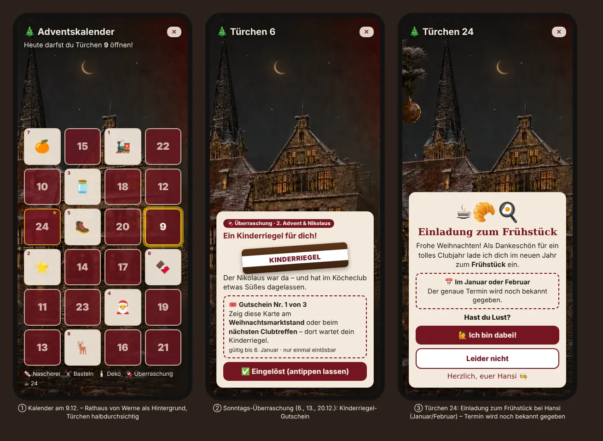

# Konzept: Neuer Adventskalender in der Club-App (Advent 2026)

Stand 06.11.2026 · Kennzeichen **KC-CLUB-ADVENT-2026** · baut auf **KC-CLUB-ADVENTSKALENDER** (Club-App 2.468.0 / 2.476.0) auf ·
Status: **Konzept – alle Fragen beantwortet (06.11.2026), bereit zur Umsetzung** · nur Text und Entwurfsbild, noch keine Funktion

Wunsch Hansi (06.11.2026): „Entwickle ein neues Konzept zum Adventskalender in der Club-App. Als Hintergrund soll das Rathaus-Bild aus der
TV-Präsentation sein. In den Türchen sind bisher nur Bastelanleitungen. Baue auch abwechselnd ein: weihnachtliche Bastelanleitung,
Weihnachts-Deko-Anleitung, einen Kinderriegel – 24. Türchen Einladung zum Frühstück im Januar oder Februar bei Hansi.“



*Entwurf (`entwurf.html`): ① Kalender am 9. Dezember · ② Sonntags-Überraschung Kinderriegel · ③ Türchen 24 mit Einladung (Termin wird noch bekannt gegeben).*

## 1. Idee in einem Satz

Der Adventskalender bekommt das **weihnachtliche Rathaus von Werne** aus der Weihnachtsmarkt-Präsentation als Hintergrund, und hinter den
Türchen wechseln sich jetzt **vier Sorten** ab – Nascherei, Basteln, Deko und an den Adventssonntagen ein **Kinderriegel** –, bis am
**24. Dezember** die **Einladung zum Frühstück bei Hansi** wartet.

## 2. Was es heute schon gibt (bleibt erhalten)

| Baustein | Stand heute | Im neuen Konzept |
|---|---|---|
| 24 Türchen, gemischte Anordnung `AK_REIHE` | Weinrot/Beige, heutiges leuchtet golden | **bleibt** (gleiche Anordnung, Mitglieder finden sich zurecht) |
| Inhalt `AK_TUERCHEN` | 23 Nasch-Bastelanleitungen + „Frohe Weihnachten“ | Registry wird um **Sorte** erweitert (Abschnitt 4) |
| Frühere Türchen nachholen, spätere gesperrt | ja | **bleibt** |
| Geöffnete Türchen merkt sich das Gerät (`kc_club_advent_<Jahr>`) | ja, kein Server | **bleibt** – nur die Antwort auf die Einladung geht über den vorhandenen Abstimmungs-Baustein (Abschnitt 7); **keine neue Tabelle** |
| Erinnerung im Info-Laufband | „🎄 Türchen … wartet auf dich“ | **bleibt**; an Sonntagen „🍫 Heute wartet eine Überraschung“ |
| Überraschung bis 30.11. (nur Admin sieht ihn) | 2.482.0 | **bleibt** |
| Wer sieht ihn? | alle Konten | **nur Mitglieder** – **kein Kalender für Gäste und Kinder-Konten** (Antwort Hansi 06.11.2026); Admins wie bisher |
| An/aus unter ⚙️ → ✨ Effekte | ja | **bleibt** |

**Keine Anleitung geht verloren:** Die 16 Nasch-Anleitungen, die nicht mehr hinter einem Türchen stehen, kommen in ein neues Fach
**„📖 Alle Naschereien“** unten im Kalender (ab 1.12. für alle sichtbar). So wird keine freigegebene Funktion entfernt (Entwicklervertrag Regel 1).

## 3. Hintergrund: das Rathaus aus der TV-Präsentation

- **Bild:** `assets/kasse-presentation/backgrounds/rathaus.png` aus der Weihnachtsmarkt-Präsentation (Repo *WM-Präsentation*, Gestaltung „Rathaus“ –
  dieselbe, die Hansi im Besuchsprotokoll als Variante „Rathaus“ abfragt). Nachtstimmung: Altes Rathaus mit Arkaden, Turm von St. Christophorus,
  Mondsichel, nasses Kopfsteinpflaster, Tannenbaum mit goldenen Kugeln, rechts eine weinrote Fläche.
- **Für die App verkleinert:** 1280 × 720 Pixel als WebP, **110 KB** statt 2,8 MB PNG (Datei liegt schon bei: `advent-rathaus.webp`). Wird erst geladen,
  wenn der Kalender geöffnet wird, und danach vom Service Worker zwischengespeichert – kein Ballast beim App-Start, kein Zusatz-Datenverkehr.
- **Handy (hochkant):** Das Bild ist Querformat. Ausschnitt `background-position: 24% center` – so steht das Rathaus mit Turm mittig hinter den
  Türchen, die Mondsichel oben. Ein leichter dunkler Verlauf oben und unten hält Überschrift und Hinweistext lesbar.
- **Tablet/PC (quer):** ganzes Bild; die Türchen stehen rechts auf der weinroten Fläche, das Rathaus bleibt links frei sichtbar.
- **Türchen:** halbdurchsichtig weinrot (`rgba(116,21,33,.72)`) mit beigem Rand – das Rathaus schimmert durch. Geöffnete Türchen beige wie bisher.
- **Schnee:** leiser Schneefall über dem Bild mit dem vorhandenen Jahreszeiten-Effekt der App (kein neuer Effekt). Wer unter ⚙️ „Bewegung
  verringern“ eingestellt hat, bekommt ein ruhiges Bild ohne Schnee.
- **Nachtmodus / große Schrift:** Die Türchenkarten bleiben beige mit dunkler Schrift (gut lesbar); bei großer Schrift 3 statt 4 Türchen je Reihe.
- **Herkunft geklärt (Antwort Hansi 06.11.2026: „Rathaus-Bild habe ich gemacht“):** Das Bild ist von Hansi selbst erstellt, die Club-App darf es
  verwenden. Beim Einbau bekommt es eine Quellenzeile („Rathaus Werne im Advent – Bild: Hansi, Köcheclub Werne“) – wie alle Bilder der App.

## 4. Abwechselnd: die vier Sorten

| Sorte | Symbol | Was hinter dem Türchen ist | Anzahl |
|---|---|---|---|
| **Nascherei** | 🍬 | Bastelanleitung für eine kleine süße Nascherei (wie bisher) | 7 |
| **Weihnachtliches Basteln** | ✂️ | Bastelanleitung ohne Essen: Sterne, Karten, Anhänger, Baumschmuck | 7 |
| **Weihnachts-Deko** | 🕯️ | Anleitung für Deko fürs Zuhause und die Festtafel | 6 |
| **Überraschung: Kinderriegel** | 🍫 | Gutschein für einen echten Kinderriegel – gibt's beim Weihnachtsessen im Januar (Abschnitt 6) | 3 |
| **Einladung** | ☕ | Frühstück bei Hansi im Januar/Februar (Abschnitt 7) | 1 |

**Rhythmus:** Nascherei → Basteln → Deko, immer reihum; an den **drei Adventssonntagen im Dezember** (6., 13., 20.12.2026) der Kinderriegel.
Der 6.12. ist zugleich **Nikolaus und 2. Advent** – passt perfekt.
Kleine Ecke oben links im geöffneten Türchen zeigt die Sorte, eine Legende unter dem Kalender erklärt die Symbole.

Registry-Erweiterung (Beispiel – nur `AK_TUERCHEN` ändern, wie es der Kommentar im Code schon vorsieht):

```js
{ art: "basteln", sym: "⭐", t: "Sterne aus Butterbrottüten", z: [...], s: [...], tipp: "..." }
{ art: "riegel",  sym: "🍫", t: "Ein Kinderriegel für dich!", gutschein: 1 }
{ art: "basteln", ..., link: "https://…" }   // Link zur echten Anleitung (Abschnitt 5.1)
{ art: "einladung", sym: "☕", t: "Einladung zum Frühstück", termine: [...] }
// art fehlt = "naschen" (alte Einträge laufen unverändert weiter)
```

## 5. Der Plan für alle 24 Türchen

| Tag | Wochentag | Sorte | Inhalt | Herkunft |
|---|---|---|---|---|
| 1 | Di | 🍬 Nascherei | Lokomotive aus Dominosteinen | bisher Türchen 1 |
| 2 | Mi | ✂️ Basteln | Sterne aus Butterbrottüten | neu |
| 3 | Do | 🕯️ Deko | Frost-Windlicht mit Salzkristallen (Glas, grobes Salz, Tannengrün – Kristalle wachsen in ein paar Tagen) | neu |
| 4 | Fr | 🍬 Nascherei | Nikolaus aus Schokokuss – „schon mal für Sonntag“ | bisher Türchen 6 |
| 5 | Sa | ✂️ Basteln | Nikolausstiefel aus Filz zum Aufhängen – rechtzeitig für heute Abend | neu |
| 6 | **So · 2. Advent · Nikolaus** | 🍫 Überraschung | **Kinderriegel-Gutschein 1/3** | neu |
| 7 | Mo | 🕯️ Deko | Girlande aus getrockneten Orangenscheiben (Backofen, 80 °C) | neu |
| 8 | Di | 🍬 Nascherei | Rentier aus Marshmallow | bisher Türchen 7 |
| 9 | Mi | ✂️ Basteln | Schneeflocken aus Papier falten und schneiden | neu |
| 10 | Do | 🕯️ Deko | Zapfenwichtel mit Filzmütze und Bart | neu |
| 11 | Fr | 🍬 Nascherei | Schneeflocke aus Brezeln | bisher Türchen 15 |
| 12 | Sa | ✂️ Basteln | Engel aus Nudeln (Baumschmuck) | bisher Türchen 5 – war schon keine Nascherei |
| 13 | **So · 3. Advent · Lucia** | 🍫 Überraschung | **Kinderriegel-Gutschein 2/3** (+ Hinweis auf das Mandarinen-Licht im Fach „Alle Naschereien“) | neu |
| 14 | Mo | 🕯️ Deko | Duft-Orange mit Nelken (Nelkenorange) | neu |
| 15 | Di | 🍬 Nascherei | Schokolöffel für heiße Milch | bisher Türchen 12 |
| 16 | Mi | ✂️ Basteln | Weihnachtskarte mit Stehauf-Tannenbäumen (springen beim Aufklappen hoch) | neu |
| 17 | Do | 🕯️ Deko | Leuchtende Doppelvase: Tannenzweige, Lichterkette und Kugeln | neu |
| 18 | Fr | 🍬 Nascherei | Hexenhaus aus Butterkeksen | bisher Türchen 4 |
| 19 | Sa | ✂️ Basteln | Geschenkpapier mit Kartoffelstempel bedrucken | neu |
| 20 | **So · 4. Advent** | 🍫 Überraschung | **Kinderriegel-Gutschein 3/3** | neu |
| 21 | Mo | 🕯️ Deko | Servietten als Tannenbaum falten (für die Festtafel) | neu |
| 22 | Di | 🍬 Nascherei | Tannenbaum aus Eiswaffel | bisher Türchen 8 |
| 23 | Mi | ✂️ Basteln | Geschenke natürlich verpacken – mit Zimtstange und Rinden-Anhänger (last minute) | neu |
| 24 | **Do · Heiligabend** | ☕ Einladung | **Frohe Weihnachten + Einladung zum Frühstück bei Hansi** | neu (ersetzt „Frohe Weihnachten!“, der Gruß bleibt drin) |

**Ins Fach „📖 Alle Naschereien“** (unverändert): Schneemann aus Pfeffernüssen, Lebkuchen-Kerze, Pinguin, Zauberstäbe, Mandarinen-Licht, Päckchen aus
Dominosteinen, Marshmallow-Schneemann, Keks-Tannen, Naschglas-Schneekugel, Apfel-Igel, Stall aus Zwieback, Schneemann-Muffin, Zuckerstangen-Herz,
Obst-Tannenbaum, Schlitten aus Zuckerstangen – plus alle sieben aus dem Kalender. Eine Nascherei im Fach öffnet sich erst, wenn ihr Türchen dran war
bzw. ab dem 1.12. (die nicht mehr verwendeten).

### 5.1 Aufbau der neuen Anleitungen

Gleich wie die Nasch-Anleitungen, damit alles einheitlich aussieht: **🧺 Du brauchst** (3–5 Dinge, die man im Haus hat oder im Bastelladen
für wenige Euro bekommt) · **✂️ So geht's** (4 Schritte, je ein Satz) · **💡 Tipp**. Zusätzlich bei Basteln und Deko:

- **⏱️ Dauer** (z. B. „ca. 20 Minuten“) und **👧 Mit Kindern?** (✅ gut geeignet / ⚠️ mit Hilfe – Schere, Backofen, Kerze).
- **Sicherheitshinweis** bei Kerzen und Backofen (wie beim Mandarinen-Licht: „nie unbeaufsichtigt brennen lassen“).
- Der Kleber-Hinweis (Zuckerguss) erscheint nur noch bei Naschereien.
- **Kleine Symbole + Link zur echten Anleitung** (Antwort Hansi 06.11.2026): In der Karte stehen das Symbol, die Kurzfassung (Material, 4 Schritte,
  Tipp) und darunter der Knopf **„🔗 Zur ausführlichen Anleitung (mit Bildern)“**. Er öffnet eine echte Bastel-/Deko-Anleitung im Internet in einem
  neuen Fenster (`target="_blank" rel="noopener"`). Keine Bilder aus dem Netz in der App selbst, keine eigenen Skizzen.
- **Auswahl der Links:** beim Einbau je Anleitung eine frei zugängliche Seite (ohne Anmeldung, ohne Bezahlschranke, möglichst wenig Werbung, deutsch),
  bevorzugt mit Schritt-Fotos oder Video. Hansi bekommt die Liste vorher zum Absegnen. Die Links stehen in der Registry (`link`) und lassen sich ohne
  Programmänderung austauschen. Zusätzlich bekommen auch die Naschereien einen Link, wo es eine gute Anleitung gibt (sonst bleibt der Knopf weg).
- Liste der Links: Abschnitt 5.2.
- Kurz vor dem 1.12. prüft ein Werkzeug (`tools/advent-links.mjs`), ob alle Links noch erreichbar sind – ein toter Link wird vorher ersetzt.
- 🔊 **Vorlesen** wie überall in der App (vorhandene Vorlese-Funktion).

Beispiel Türchen 2 – **Sterne aus Butterbrottüten** ✂️ · ca. 20 Min. · 👧 mit Kindern gut geeignet
- 🧺 7 Butterbrottüten (braun oder weiß), Klebestift, Schere, Faden
- ✂️ 1. Die Tüten flach aufeinanderkleben – immer unten einen breiten Streifen und senkrecht einen in der Mitte („T“-Form).
  2. Den Stapel oben spitz oder rund zuschneiden, Muster (Dreiecke, Herzen) seitlich herausschneiden.
  3. Die oberste und die unterste Tüte zusammenkleben – der Stern klappt auf.
  4. Faden durchziehen und ans Fenster hängen.
- 💡 Mit Lichterkette dahinter leuchtet der Stern wie eine Laterne.
- 🔗 Zur ausführlichen Anleitung (mit Bildern)

### 5.2 Linkliste (gesucht und geprüft 06.11.2026 – wartet auf Hansis OK)

Jeder Link wurde im Browser geöffnet: Seite lädt, Anleitung ist ohne Anmeldung und ohne Bezahlschranke lesbar, Inhalt passt zum Türchen.
**Nicht genommen:** selbst.de und wunderweib.de (leiten auf eine Bezahl-/Einwilligungsseite um), rossmann.de und lusini.com (Seite sperrt mit
„Einen Moment …“-Prüfung), tutkit.com (lädt nicht). Wo die ursprüngliche Idee keine gute Anleitung hatte, wurde der Titel an die gefundene
Anleitung angepasst (Türchen 3, 16, 17, 23).

| Tag | Sorte | Anleitung | Link | Was man dort findet |
|---|---|---|---|---|
| 2 | ✂️ | Sterne aus Butterbrottüten | [dm.de](https://www.dm.de/tipps-und-trends/bastelideen/bastelideen-weihnachten/himmlische-papiersterne-aus-butterbrottueten-475304) | Material, Schritte mit Bildern |
| 5 | ✂️ | Nikolausstiefel aus Filz | [dm.de](https://www.dm.de/tipps-und-trends/bastelideen/bastelideen-kinder/nikolausstiefel-andere-weihnachtsdeko-aus-filz-58928) | Filz, Locher, Pfeifenputzer, von Hand nähen |
| 9 | ✂️ | Schneeflocken aus Papier | [WDR – Die Maus (PDF)](https://www.wdrmaus.de/elefantenseite/elternseiten/selbermachen/pdfs/Bastelanleitung-Papier-Schneeflocke.pdf) | 1 Seite, kindgerecht: dreimal falten, schneiden, auffalten |
| 12 | ✂️ | Engel aus Nudeln | [TU Chemnitz, Adventskalender (17)](https://www.tu-chemnitz.de/advent/2010/17/) | „Hartweizenengel“, 6 Schritte mit Fotos |
| 16 | ✂️ | Karte mit Stehauf-Tannenbäumen | [fuersie.de](https://www.fuersie.de/lifestyle/weihnachten/galerie/weihnachtskarten-selbermachen) | Bildergalerie, Abschnitt „Stehauf-Tannenbäume“ |
| 19 | ✂️ | Geschenkpapier mit Kartoffeldruck | [utopia.de](https://utopia.de/ratgeber/geschenkpapier-selber-machen-gestalten-einfach_36918/) | Stempel schnitzen, drucken, trocknen – mit Fotos |
| 23 | ✂️ | Geschenke natürlich verpacken (Zimt, Rinden-Anhänger) | [VBS Hobby, Anleitung Nr. 3411 (PDF)](https://www.vbs-hobby.at/natuerliche-geschenkverpackung-zu-weihnachten-t6007/?format=pdf) | 3 Schritte, ca. 30 Min., Einsteiger |
| 3 | 🕯️ | Frost-Windlicht mit Salzkristallen | [Helene-Weber-Haus (PDF)](https://www.heleneweberhaus.de/wp-content/uploads/2022/11/Upcycling-Schneelichter-aus-Salzkristallen.pdf) | 1 Seite mit Foto: Salz, Wasser, Wärme, Tannengrün |
| 7 | 🕯️ | Girlande aus Orangenscheiben | [nau.ch](https://www.nau.ch/lifestyle/wohnen/orangegirlande-simple-weihnachtsdeko-zum-selbermachen-65826299) | 100 °C, ca. 1 Std., auffädeln – mit Fotos |
| 10 | 🕯️ | Zapfenwichtel | [VBS Hobby, Anleitung Nr. 3406 (PDF)](https://www.vbs-hobby.at/zapfenwichtel-basteln-t6004/?format=pdf) | Mütze, Bart, Nase – Einsteiger |
| 14 | 🕯️ | Duft-Orange mit Nelken | [utopia.de](https://utopia.de/ratgeber/weihnachtsduefte-die-klassiker-ohne-chemie-einfach-selbstgemacht_272916/) | Abschnitt Nelkenorange (schwedischer Brauch mit 24 Nelken) |
| 17 | 🕯️ | Leuchtende Doppelvase | [desired.de](https://www.desired.de/artikel/kreativer-weihnachtszauber-selbstgemachte-deko-die-deinen-tisch-zum-strahlen-bringt--g34f84g8rx) | 2 Vasen, Lichterkette, Kugeln, Zweige – 5 Schritte |
| 21 | 🕯️ | Servietten-Tannenbaum | [dm.de](https://www.dm.de/tipps-und-trends/bastelideen/bastelideen-weihnachten/weihnachtsbaum-serviette-2570968) | Falt-Anleitung mit Bildern |
| 8 | 🍬 | Rentier aus Marshmallow | [ORF Kids, „Weihnachtliche Jause“ (PDF)](https://tv.orf.at/program/kids/box-weihnachtliche-jause100.pdf) | genau dieses Rentier (Marshmallow, Schoko, Brezel-Geweih) |
| 15 | 🍬 | Schokolöffel | [dm.at](https://www.dm.at/inspiration-und-beratung/ernaehrung/rezepte-kochtipps/schokoloeffel-rezept-491614) | Rezept mit Varianten |
| 18 | 🍬 | Hexenhaus aus Butterkeksen | [lecker.de](https://www.lecker.de/buntes-hexenhaus-26290.html) | Rezept mit Butterkeksen und Guss |

**Ohne Link** (keine passende Anleitung gefunden – die Kurzanleitung in der App reicht): 🍬 Lokomotive aus Dominosteinen (1), Nikolaus aus Schokokuss (4),
Schneeflocke aus Brezeln (11), Tannenbaum aus Eiswaffel (22). Die 🍫 Kinderriegel-Türchen und Türchen 24 brauchen keinen Link.

Hinweis für die App: VBS-Hobby ist ein Bastelladen – die Anleitungen sind kostenlos, nennen aber Produkte aus dem Shop. Die Kurzfassung in der
App nennt nur Dinge aus dem Haushalt bzw. dem normalen Bastelbedarf.

## 6. Kinderriegel an den Adventssonntagen

Ein Adventskalender ohne Schokolade? Nicht im Köcheclub. An den drei Sonntagen gibt es **einen echten Kinderriegel** – im Türchen als Gutschein,
den Riegel selbst gibt es **beim Weihnachtsessen im Januar** (Antwort Hansi 06.11.2026):

1. **Türchen öffnen:** Ein Kinderriegel rutscht aus dem Türchen (kleine Animation, selbst gezeichnet – **kein Markenlogo**, nur der Schriftzug wie im
   Entwurf), Text „Ein Kinderriegel für dich!“, an Nikolaus „Der Nikolaus war da …“.
2. **Gutschein:** „🎟️ Gutschein Nr. 1 von 3 – dein Kinderriegel wartet beim **Weihnachtsessen im Januar** auf dich.“
3. **Kein Abhaken** (Antwort Hansi 06.11.2026): kein „Eingelöst“-Knopf, keine Liste, **keine neue Tabelle, kein Server**. Der Gutschein ist nur eine
   schöne Karte; ausgegeben wird beim Weihnachtsessen einfach an alle, die da sind.
4. **Mehrere Gutscheine:** Wer erst am 20.12. reinschaut, sieht „🍫 3 Kinderriegel warten beim Weihnachtsessen auf dich“.
5. **Erinnerung:** Kurz vor dem Weihnachtsessen – sobald der Termin im 📅 Kalender steht – zeigt die App einmal im Info-Laufband
   „🍫 Denk an deine Kinderriegel – heute beim Weihnachtsessen!“ (nur bei Mitgliedern, die mindestens ein Riegel-Türchen geöffnet haben;
   Erkennung über den Termin, keine Freitext-Eingabe).

Kosten: Die Riegel bezahlt der Club (3 Riegel je Mitglied; Packung mit 10 Riegeln ca. 2,50 €). Für die App entstehen **keine Kosten** (kein neuer Dienst).

## 7. Türchen 24: Einladung zum Frühstück bei Hansi

Am Heiligabend öffnet sich das goldene Türchen 24. Es ist im Kalender **immer doppelt so groß** (2 × 2 Felder, mit ★; Hansi 06.11.2026) – die freie Ecke im Raster füllt die Kochmütze:

1. **Weihnachtsgruß** (bleibt aus dem bisherigen Türchen 24): „Der Köcheclub Werne wünscht dir und deiner Familie frohe Weihnachten und gesegnete Festtage!“
2. **Einladungskarte** im Stil einer Briefkarte auf beigem Grund, das Rathaus groß im Hintergrund, kleiner Goldglanz beim Öffnen:
   „☕🥐🍳 **Einladung zum Frühstück** – Weil das Grillen im August bei mir leider ausgefallen ist, lade ich dich im neuen Jahr zum Frühstück ein. Herzlich, euer Hansi 🧑‍🍳“ (Text: Hansi 06.11.2026)
   Die Einladung gilt **nur für das Mitglied** (keine Partner, Antwort Hansi 06.11.2026) – deshalb auch kein „Wir kommen zu zweit“.
3. **📅 Termin:** „Im **Januar oder Februar** – der genaue Termin wird noch bekannt gegeben.“ (Antwort Hansi 06.11.2026: „Termin wird noch bekannt
   gegeben“ – deshalb **keine Terminauswahl** im Türchen.)
4. **🙋 Ich bin dabei!** / **Leider nicht** – nur „Hast du Lust?“, ohne Datum. Damit weiß Hansi früh, mit wie vielen er rechnen kann. Dafür wird der
   **vorhandene Abstimmungs-Baustein** genutzt (Vorschläge → 🗳️ Abstimmung, „❓ Eine Frage“): Hansi legt die Abstimmung „Frühstück im neuen Jahr“
   vorher **versteckt** an, Türchen 24 zeigt sie an. Kein Parallel-Baustein (Entwicklervertrag Regel 3).
5. **Bekanntgabe:** Sobald Hansi Tag, Uhrzeit und Ort festlegt, trägt er einen normalen **Termin** im 📅 Kalender ein – mit Zusage, Mitfahrt und
   Erinnerung wie gewohnt; die übliche Termin-Benachrichtigung geht an alle. Türchen 24 (und das Fach im Kalender bis Ende Februar) zeigt dann
   „📅 Jetzt steht's fest: … – Ort …“ mit Knopf „Im Kalender ansehen / zusagen“. Wer vorher „Ich bin dabei“ getippt hat, bekommt den Hinweis im
   Info-Laufband zuerst: „☕ Das Frühstück bei Hansi steht fest – sagst du zu?“
6. **Wer das Türchen erst später öffnet** (bis 31.12. – danach ist der Kalender wie bisher vorbei), kann trotzdem antworten. Ab 1.1. bleibt die
   Einladung über einen Hinweis im Info-Laufband erreichbar, bis der Termin vorbei ist.
7. **Ort und Uhrzeit** stehen in der Karte, sobald Hansi sie bekannt gibt.

## 8. Ablauf im Dezember (was das Mitglied sieht)

1. **1.12., erster App-Start:** Kurze Karte „🎄 Der Adventskalender ist da – mit Rathaus, Bastelideen, Deko und Überraschungen. Öffnen?“ (einmalig).
2. **Jeden Tag:** Erinnerung im Info-Laufband, solange das heutige Türchen zu ist (wie bisher). Sonntags: „🍫 Heute wartet eine Überraschung“.
3. **Türchen antippen:** Türchen klappt auf (bisherige Animation), Inhalt erscheint als Karte über dem Rathaus.
4. **24.12.:** Türchen 24 leuchtet golden mit Sternchen, nach dem Öffnen Goldglanz und Einladung.
5. **25.–31.12.:** alle Türchen offen zum Nachlesen; danach verschwindet der Kalender bis zum nächsten Jahr (Fach „Alle Naschereien“ bleibt in der Hilfe auffindbar).

## 9. Umsetzung, Tests, Definition of Done

- **Wo:** Club-App (`KC-Clubapp`): `app.js` (Registry `AK_TUERCHEN`, `akZeigen`, `akTuer`), `index.html` (CSS `.ak-*`), neues Bild `advent/rathaus.webp`,
  **keine Änderung am Club-Server und keine neue Tabelle**; Sichtbarkeit `akSichtbar` um „kein Gast, kein Kinder-Konto“ erweitern. Hilfe-Eintrag „adventskalender“ anpassen
  („jeden Tag ein Türchen – Naschereien, Basteln, Deko, sonntags eine Überraschung, am 24. eine Einladung“).
- **Einspielen:** gebündelt zum 12- oder 20-Uhr-Termin (KC-DB-SPARSAM), spätestens im Bündel **Ende November**; vorher Vorschau für Admin (gibt es schon).
- **Tests** (neu `tests/advent-2026.test.mjs`):
  - genau 24 Einträge; Reihenfolge der Sorten wie Abschnitt 5; Sonntage 6./13./20.12.2026 sind `riegel`; Tag 24 ist `einladung`;
  - jede Anleitung hat 3–5 Zutaten/Materialien, 4 Schritte, Tipp; Basteln/Deko haben Dauer und Kinder-Hinweis;
  - alle 23 bisherigen Nasch-Anleitungen sind noch vorhanden (Kalender oder Fach „Alle Naschereien“);
  - Hintergrundbild ≤ 150 KB, im Service-Worker-Zwischenspeicher, Quellenzeile vorhanden;
  - jede Bastel-/Deko-Anleitung hat einen `link` mit `https://`; Knopf öffnet in neuem Fenster mit `rel="noopener"`;
  - Gäste und Kinder-Konten sehen den Kalender nicht (weder Laufband noch Hilfe noch ⚙️ Effekte);
  - Riegel-Türchen haben keinen „Eingelöst“-Knopf und rufen keinen Server auf;
  - Browser-Prüfung Handy hochkant und Tablet quer: Rathaus sichtbar, Text lesbar (Kontrast ≥ 4,5 : 1), große Schrift → 3 Spalten.
- **Fertig, wenn:** alle Tests grün · Hansi hat die Vorschau am Handy abgenommen · Bildquelle vermerkt · Frühstücks-Abfrage „Hast du Lust?“ angelegt ·
  CHANGELOG-Eintrag · Hilfe-Text aktualisiert · Rückweg = vorherige App-Version.

## 10. Entscheidungen von Hansi (06.11.2026)

| # | Frage | Antwort |
|---|---|---|
| 1 | Rathaus-Bild – Herkunft? | **Von Hansi selbst gemacht** – darf verwendet werden |
| 2 | Kinderriegel oder Kinderrätsel? | **Echter Riegel** |
| 3 | Gutschein abhaken? | **Kein Abhaken** – Riegel gibt es beim **Weihnachtsessen im Januar** |
| 4 | Wo gibt es den Riegel? | **Beim Weihnachtsessen im Januar** |
| 5 | Bilder in den Anleitungen? | **Kleine Symbole + Link zur echten Anleitung** |
| 6 | Frühstückstermine zur Auswahl? | **Termin wird noch bekannt gegeben** – keine Auswahl im Türchen |
| 7 | Partner beim Frühstück? | **Nein** – Einladung nur für das Mitglied |
| 8 | Kalender für Gäste/Kinder? | **Nein** – nur Mitglieder |

Noch zu tun vor dem Einbau: Hansi segnet die Linkliste ab (Abschnitt 5.2).

---
Dateien in diesem Ordner: `KONZEPT_ADVENTSKALENDER_2026.md` (dieses Konzept), `entwurf.html` + `entwurf.webp` (Entwurfsbild, keine Funktion),
`advent-rathaus.webp` (Rathaus-Bild für die App vorbereitet, 1280 × 720, 110 KB). Kopie im Club-App-Repo: `docs/adventskalender-2026/`.
